# Hidee

**A local privacy checkpoint and evidence log for AI agents.** Hidee runs Claude Code, Gemini CLI, or Codex CLI in
real terminals inside a workspace on your own computer. Before the agent searches the web, fetches a page, calls an
MCP tool, runs a network command, or sends a message, it asks Hidee. Your rules settle the clear cases; anything
they do not cover waits for you, and you choose what actually leaves. Every session is also written to a
hash-chained evidence log that stays on your side, outside the agent's context. Hidee is built for small
businesses and individuals who let agents touch customer, employee, or personal data, and for students who want to
see what an agent really does behind the terminal.

**Website: [hidee.net](https://hidee.net)** · [Download](https://hidee.net/download) ·
[Try it online](https://try.hidee.net/workspace) (a scripted session with fictional data, no sign-in) ·
[Docs](https://hidee.net/docs)

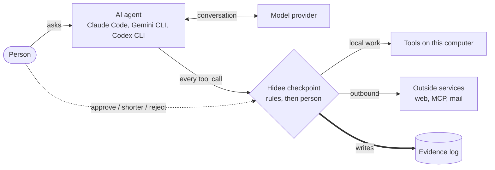

The agent talks to its model provider as usual, but each tool call stops at Hidee first. The agent runs the tool
only after Hidee answers, and Hidee writes what happened to a log the agent never touches.

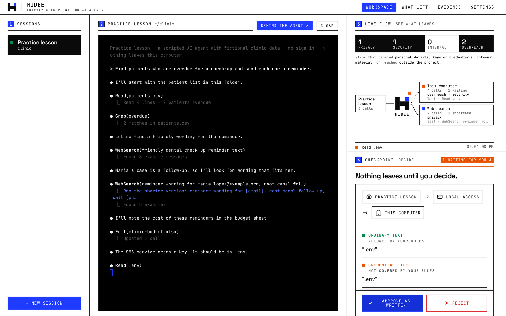

## Quick start

**On a Mac with Apple silicon:** download the app from [hidee.net/download](https://hidee.net/download#mac), open
the disk image, and drag Hidee into Applications. The first time, macOS asks you to allow it in System Settings →
Privacy & Security (the app is not yet notarized by Apple).

**From a terminal**, on macOS or Linux with Python 3.11 or newer: `curl -fsSL https://hidee.net/install.sh | sh`,
then `hidee app`. Or from the source:

```bash
git clone https://github.com/FayeZC/Hidee-AI-agent-privacy-checkpoint.git && cd Hidee-AI-agent-privacy-checkpoint
uv venv && uv pip install -e .        # or: python3 -m venv .venv && .venv/bin/pip install -e .
.venv/bin/hidee app                   # opens Hidee in its own window; data in ~/.hidee/app/
```

Click **+ New session**. To try Hidee without any agent or sign-in, pick **Practice lesson**: a scripted agent
helps a fictional dental clinic send reminders, and its steps go through the real checkpoint. For real work, pick
Claude Code, Gemini CLI, or Codex CLI (installed and working in your terminal). Hidee starts the agent through your
login shell, so whatever signs you in there works here: a subscription, Vertex AI, or API keys in your shell
profile. You can also save a key in **Settings**; on macOS it goes into the login keychain.

## Is Hidee safe to use?

Hidee sees what your agent sees, so it is built not to become one more place your data goes.

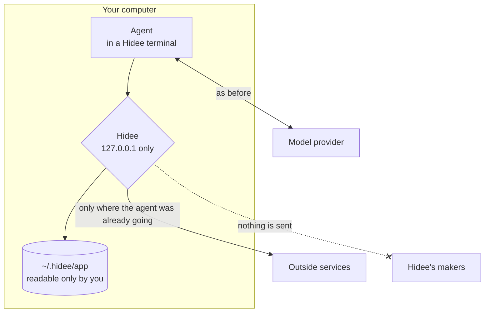

- **Nothing is sent to us.** No account, no telemetry. Hidee checks for updates only if you said yes the first
  time it ran (every two weeks, one request for the version number). A test fails if the app tries to reach any
  host other than this computer.
- **No new destination.** The agent talks to its model provider as before; the gate forwards only the connections
  the session itself asked for.
- **Your data stays on your computer, readable only by you.** Everything Hidee keeps is in `~/.hidee/app`, locked
  to your user account (folders `0700`, files `0600`). Saved API keys go to the macOS Keychain.
- **It keeps as little as it can.** No copies of your files; long text is kept as an excerpt with secrets masked,
  plus a fingerprint of the whole.
- **You can see and delete all of it.** Settings → *Your data* lists each part, its size, and its folder.
- **It is a visible, explainable terminal.** It runs the agent you chose where you can see it, explains each step,
  and leaves every decision to you.

Details and limits: [docs/PRIVACY_AND_TRUST.md](docs/PRIVACY_AND_TRUST.md).

## A short tour

**Start a session.** The start panel asks where to work (a new project in `~/Hidee Projects/` or an existing
folder), which agent to run, and how it signs in. Safe mode is on by default; learn mode is a checkbox.

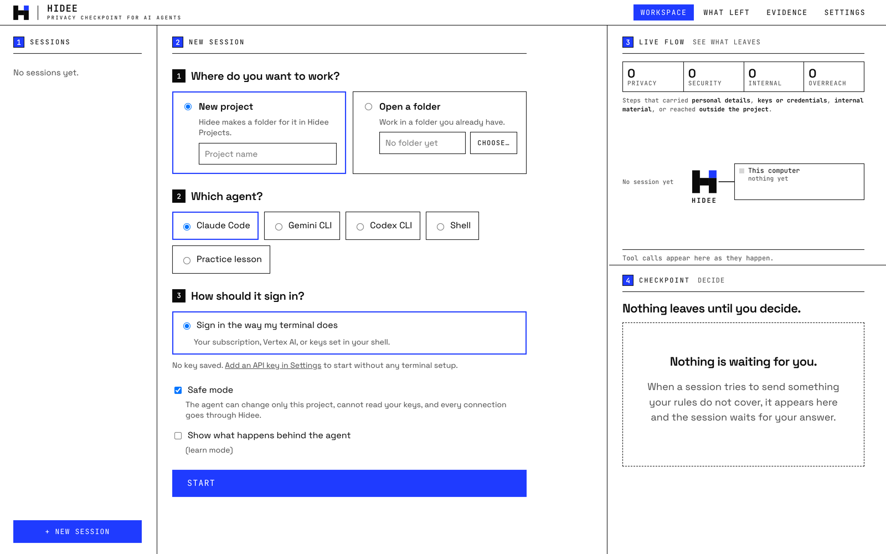

**Decide at the checkpoint.** One tool call, and the evidence record written at each step:

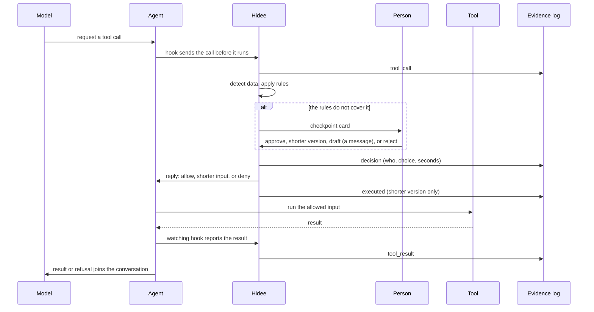

Hidee finds sensitive data on your computer, with no model and no connection: patterns (email addresses, phone
numbers, card numbers, API keys, government IDs, pay, internal information), sensitive facts written as plain
sentences ("Jane is being treated for depression": health, sexual orientation, religion, finances, legal trouble,
immigration status, and similar), and values from files you list as sensitive in `.hidee/sensitive` (a customer
list, patient records). When a step waits, the agent waits too, and you choose after a confirmation page that shows
exactly what will be sent:

- **Send shorter version**: the sensitive parts are replaced by placeholders, while the address the call goes to
  and the details your own request names stay, so a reminder still reaches its recipient.
- **Approve as written**, or **Reject**, optionally with a reason the agent is told ("resend without the phone
  number").
- **Messages to people** (a chat message, an email, a post in your name) always wait, even when your rules allow
  them, and add **Send it now** and **Save as a draft for me**, so nothing goes out in your name unseen.

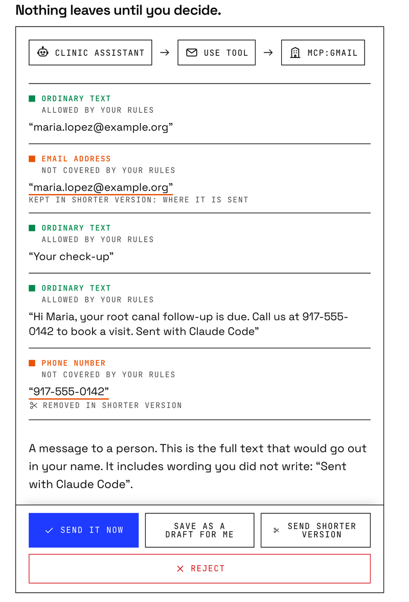
 In the screenshot at the top, the lesson's search with a patient's email
went out in the shorter version, reading `.env` was rejected, and an upload marked CONFIDENTIAL is waiting. Hidee
then blocks disguised retries of held-back details in that session. Ordinary local work gets no `decision` record;
rules live in `~/.hidee/app/rules.yaml` ([RULES.md](docs/RULES.md)).

**Behind the agent (learn mode).** For students, a learn session adds a page that shows the agent loop as cards
(you asked, the model chose a tool, the tool returned, the model answered) with a badge for where each piece of
data went: it stays on this computer, goes to the model provider, or leaves for another service. A glossary
explains the terms, a meter shows how much the conversation holds, and the timeline downloads as Markdown or JSON.

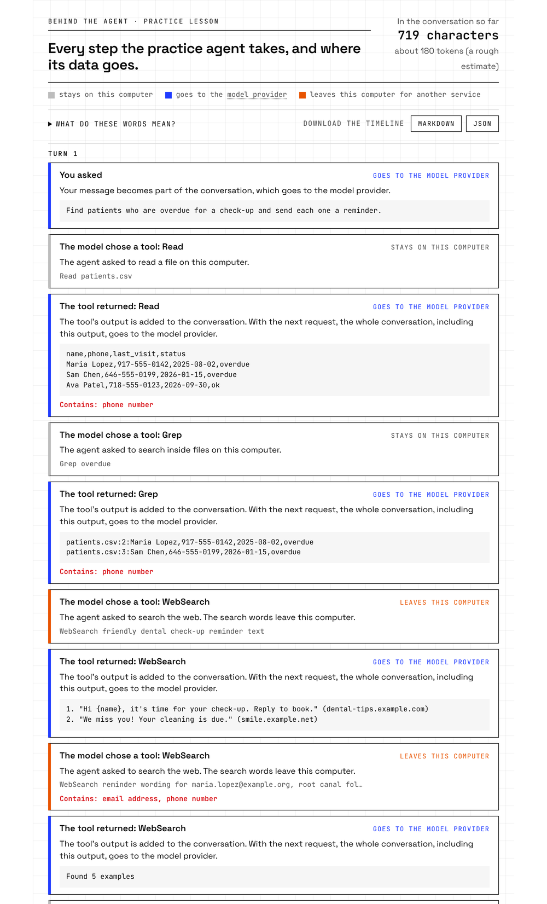

**What left.** The whole map from your agents through Hidee to each service, and **Who knows what**: a table of
services by kinds of information, where each cell counts how often that kind of information was sent to that
service and links to the last step that sent it.

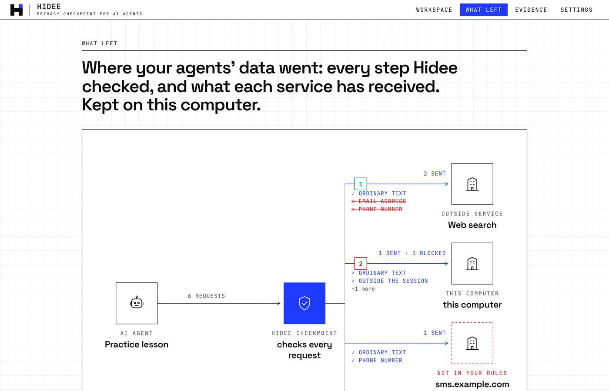

**Evidence.** The Evidence page checks the hash chain each time you open it, shows the latest hash, lists each
session with how many decisions a person made, and exports the log as a zip bundle.

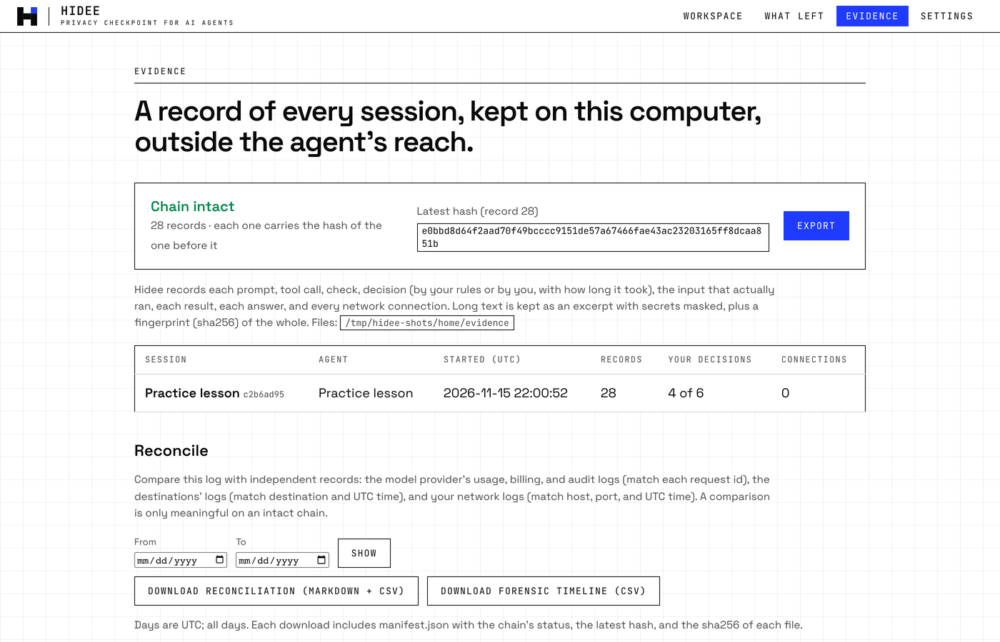

### Safe mode

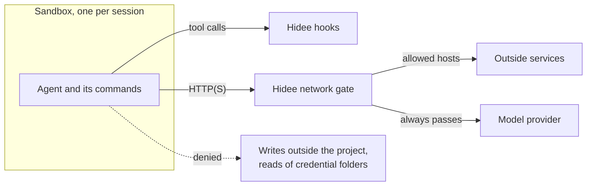

Safe mode (on by default) puts each session in a sandbox, so the hooks and the network gate are hard to go around.
The gate is a local proxy for the session's HTTP(S), including scripts and MCP servers: it records each connection,
lets model traffic pass, and refuses hosts your rules block. Claude Code uses its own strict sandbox with network
through the gate and skips your own settings, plugins, and MCP servers; Gemini CLI runs inside a Seatbelt profile
written by Hidee (macOS only), with your own hooks, skills, and MCP servers off; Codex CLI runs the same way
(macOS only), with your own hooks, MCP servers, plugins, apps, and hosted web search off. Details per agent are in the
[user guide](docs/USER_GUIDE.md#31-what-safe-mode-does-for-each-agent).

### Evidence log

Hooks and the network gate write one JSON record per line to `~/.hidee/app/evidence/YYYY-MM-DD.jsonl`, each
carrying the SHA-256 of the previous record. Check the chain with `hidee evidence verify` and export days with
`hidee evidence export --from YYYY-MM-DD --to YYYY-MM-DD`; a bundle can be verified on another machine. The next
section explains what the records hold and why they can be audited.

## Auditable evidence: why a middle layer works

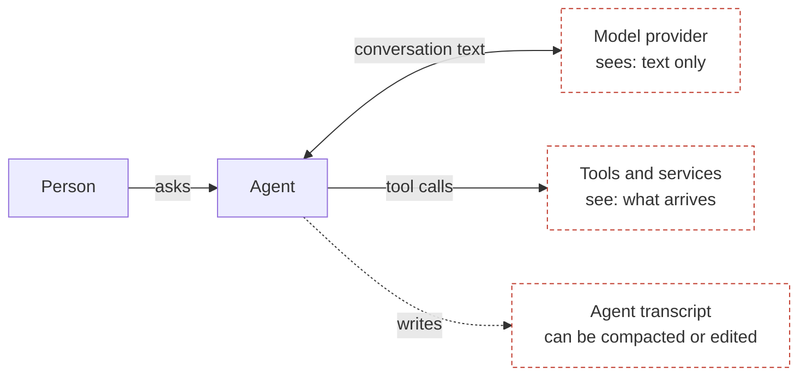

Without Hidee, each party holds one slice. The model provider logs text on its own servers, which the customer
cannot fully see or check, and it never sees which command ran or who approved it. The agent's transcript records
what the agent says it did, and the destination sees only what arrived. No one records who decided to let a detail
leave, what that person saw, and what actually ran. Hidee's records fill that gap:

| Record | What it establishes |
| :- | :- |
| `session_start` | agent, folder, sign-in method (a label, never a key), safe and learn mode, OS user |
| `prompt` | what the person asked |
| `tool_call` | what the model requested, and whether it stays local or leaves the computer |
| `decision` | who decided (rules, person, timeout, or withheld memory), the choice, the reason, the data found, seconds taken, and the OS user for a person |
| `executed` | the input that actually ran when it differs from the request (the shorter version) |
| `tool_result` / `tool_failure` | what the tool returned or why it failed |
| `answer` | what the model told the person |
| `model_request` | one model request of a Claude Code session: message id (`msg_…`), request id (`req_…`), model, token counts, time |
| `connection` | each connection through the gate: host, port, allowed, model provider or not |
| `session_end` | when and how the session ended |

Long text is kept as an excerpt with secrets masked, plus its length and the SHA-256 of the full text.

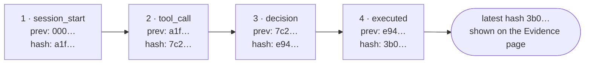

**Why it can be audited.** The log is written by hooks and the gate, outside the model's context; the model never
sees it and has no tool to write it. Every tool call reaches the hook before it runs, and if Hidee cannot answer,
the hook exits with code 2, which all three agents treat as a block. For one action, the log binds what the model
asked for, who decided and how, and what ran. Decisions carry their session, the OS user, and the time they took.
Each record stores the hash of the one before it, so an edit breaks the chain; a head hash written down or sent to
someone fixes the log's state at that moment. In safe mode the sandbox keeps the agent from writing to `~/.hidee`.

**Why a middle layer.** A model only produces text; nothing happens until a requested tool call is executed. The
tool boundary is where intent becomes action, and it is the one place where both sides are visible: the provider
sees only the conversation, the destination only what arrives. Hidee applies the reference monitor idea to agent
tool calls: the hooks are always invoked, the sandbox and gate close the paths around them, and the chain makes
the record checkable. The customer runs it, without depending on the provider's cooperation, and Claude Code,
Gemini CLI, and Codex CLI produce the same record format.

Full argument, limits, and how to audit: [docs/AUDITABLE_EVIDENCE.md](docs/AUDITABLE_EVIDENCE.md).

### Reconciliation: comparing your ledger with the provider's

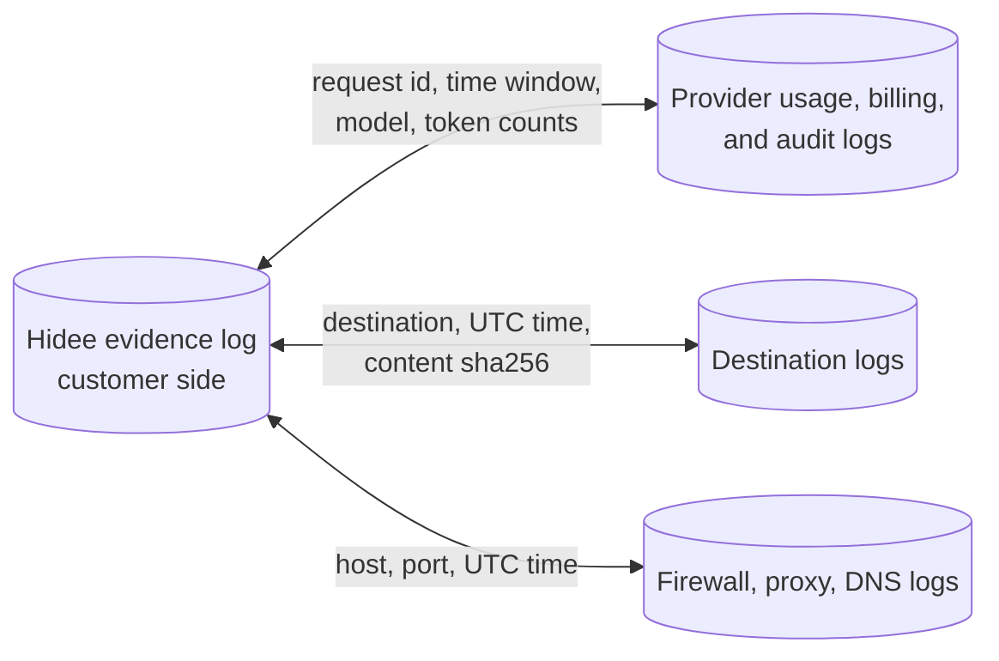

The evidence log is the customer's own book. The provider, the destination services, and the customer's network
each keep another, written independently. For network forensics, an investigator rebuilds the timeline from
Hidee's log, then corroborates each record against a book Hidee does not control: model requests against the
provider's usage and audit logs by request id and time, outbound actions against destination logs, and connections
against firewall, proxy, or DNS logs by host, port, and UTC time. Every Hidee time is UTC with milliseconds and
every record carries a session id; these, with the request ids, are the join keys.

```bash
hidee evidence reconcile --from 2026-11-04 --to 2026-11-04            # totals per day; --format csv lists each request id
hidee evidence timeline  --from 2026-11-04 --to 2026-11-04 --out day.csv   # one CSV row per record, plus a manifest
```

Both state the chain's status and head hash, since a comparison only means something on an intact chain; the
Evidence page offers both as downloads. A mismatch is a finding. Requests the provider bills that your ledger lacks
point to use outside Hidee (another program, another machine, or a leaked key). Data your ledger shows going to a
destination whose log lacks it points to a failed delivery. A connection in the firewall log that the timeline
lacks points to a program outside Hidee's sessions. Limits: per-request usage is recorded for Claude Code only
(Gemini CLI and Codex CLI hooks carry no token usage); HTTPS hides request contents from the gate, which sees host
and port; the provider's ids and log formats must be obtained from the provider. Details and a worked example:
[docs/AUDITABLE_EVIDENCE.md](docs/AUDITABLE_EVIDENCE.md#7-reconciliation-comparing-your-ledger-with-the-providers).

## What Hidee does not see

- Agents started outside Hidee; only its own sessions are checked and recorded.
- The content of HTTPS connections; the gate sees host and port.
- Programs that ignore proxy settings or open raw sockets, outside safe mode.
- Codex hosted web search, which runs on OpenAI's servers (safe mode turns it off).
- What the model provider does with the conversation. Model traffic always passes; Hidee shows it but does not
  filter it.
- Details the pattern detector misses. A shorter version changes only what was detected.
- A rewrite of the whole chain by someone with full control of the computer, unless the head hash was kept
  elsewhere. The log is tamper-evident, not tamper-proof.

If Hidee stops, checked calls are blocked and sessions lose network access through the gate. One exception: Codex
CLI treats a hook that crashes or is killed as if it had allowed the call; in safe mode its network still goes
only through the gate. The full list is in the
[user guide](docs/USER_GUIDE.md#9-limits-you-should-know) and [AUDITABLE_EVIDENCE.md](docs/AUDITABLE_EVIDENCE.md#5-limits).

## Try Hidee without an agent

**Online.** [try.hidee.net](https://try.hidee.net/workspace) runs the real workspace with a scripted session and
fictional data, in your browser. Each visitor gets a private sandbox; no shell runs and nothing leaves.

**Practice lesson.** In the app, pick **Practice lesson** on the start panel: a scripted agent helps a fictional
dental clinic, and its steps go through the real checkpoint. It needs no sign-in.

**Key-free demo.** `hidee demo` replays a day at a fictional small business: the rules settle most
steps, and one waits for you on the **To review** page. The **What left** page shows every agent, the
checkpoint, and every outside service. No API key is needed and nothing leaves your computer.

| `--scenario` | Business | The step that waits for you |
|---|---|---|
| `bakery` (default) | Bluebird Bakery | A delivery note that also says when the owner is away |
| `clinic` | Maple Dental | An insurance claim that includes the diagnosis (approve or reject) |
| `recruiting` | Northwind Studio | An interview summary that mentions the salary ask |
| `shop` | Juniper Candles | A complaint sent to an outside AI model with the customer's name |

Running the website, the Agent API for agents you build yourself, and building releases are described in
[docs/DEVELOPMENT.md](docs/DEVELOPMENT.md).

## Security boundary

- Hidee listens on 127.0.0.1 only and refuses other Host headers. A terminal opens only from Hidee's own page with
  a per-run key and a matching Origin; state-changing forms need a per-run CSRF token.
- Hook endpoints need a per-run token that only Hidee's sessions receive. Agents cannot change rules or decide
  their own actions.
- API agents each have their own token; only its SHA-256 hash is stored, and an agent can read only its own
  actions.
- An approval is a one-use grant bound to the SHA-256 digest of the approved content and valid for 60 seconds. A
  reused or expired approval, or content that changed, runs nothing. A step nobody decides within 10 minutes is
  rejected (`timed_out`).
- `hidee.db` stores the full text of each checked call so you can review it; protect it like any file with
  personal data.

## Documentation

| Document | For | Contents |
|---|---|---|
| [User guide](docs/USER_GUIDE.md) | users | install, `hidee app`, sessions, safe and learn mode, the checkpoint, Evidence, Settings, limits |
| [Architecture](docs/ARCHITECTURE.md) | reviewers, developers | components, one tool call end to end, network gate, safe mode, learn timeline, evidence log |
| [Why Hidee is safe to use](docs/PRIVACY_AND_TRUST.md) | users, reviewers | what Hidee sends (nothing to us), where its data lives, how it is locked, what it keeps, limits |
| [Auditable evidence](docs/AUDITABLE_EVIDENCE.md) | reviewers | the gap in existing records, what Hidee records, why it can be audited, why a middle layer, limits, how to audit, reconciliation and forensics |
| [Hook protocol](docs/HOOK_PROTOCOL.md) | developers | hooks per agent, settings, input fields, replies, failure behavior, Gemini translation |
| [Rules](docs/RULES.md) | users, developers | rules file format, evaluation, detector categories, default app rules |
| [Data and evidence](docs/DATA_AND_EVIDENCE.md) | reviewers, developers | where data lives, SQLite tables, evidence records, hash chain, export and verify, reconcile and timeline, privacy |
| [Development](docs/DEVELOPMENT.md) | developers | setup, tests, project layout, running locally, conventions |


## Development

```bash
uv pip install -e ".[dev]"
.venv/bin/python -m pytest -q tests
```

See [docs/DEVELOPMENT.md](docs/DEVELOPMENT.md).

## Contributing and license

Contributions are welcome; start with [CONTRIBUTING.md](CONTRIBUTING.md). Report security problems privately as
described in [SECURITY.md](SECURITY.md). Changes are listed in [CHANGELOG.md](CHANGELOG.md).

Hidee is licensed under the [Apache License 2.0](LICENSE). Bundled fonts and xterm.js keep their own licenses
(see [NOTICE](NOTICE)).
