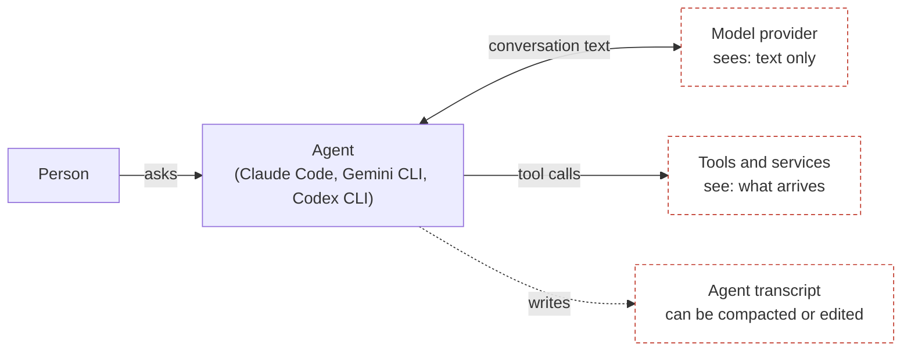
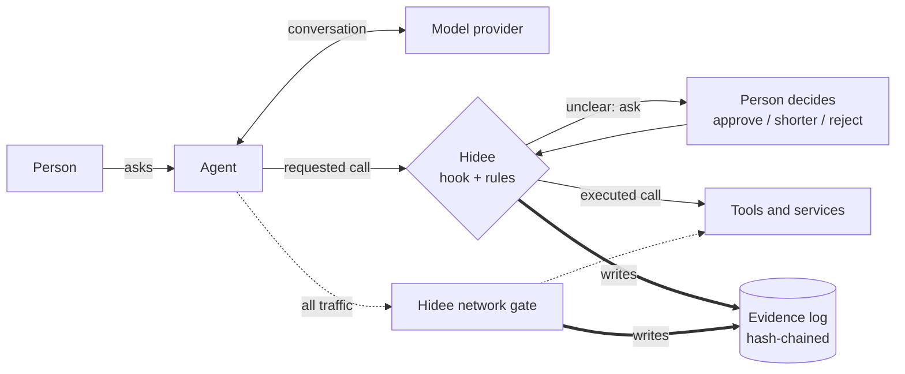
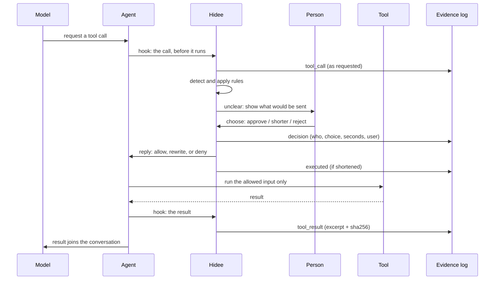
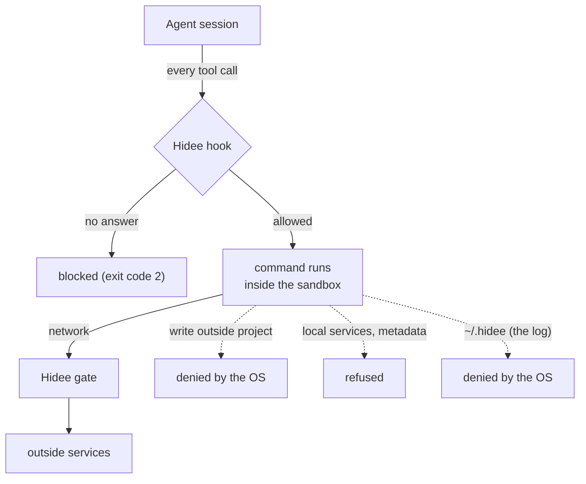
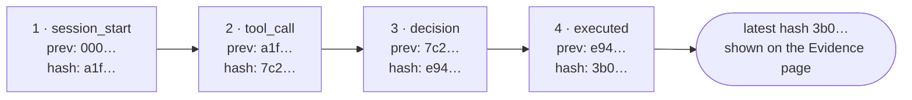
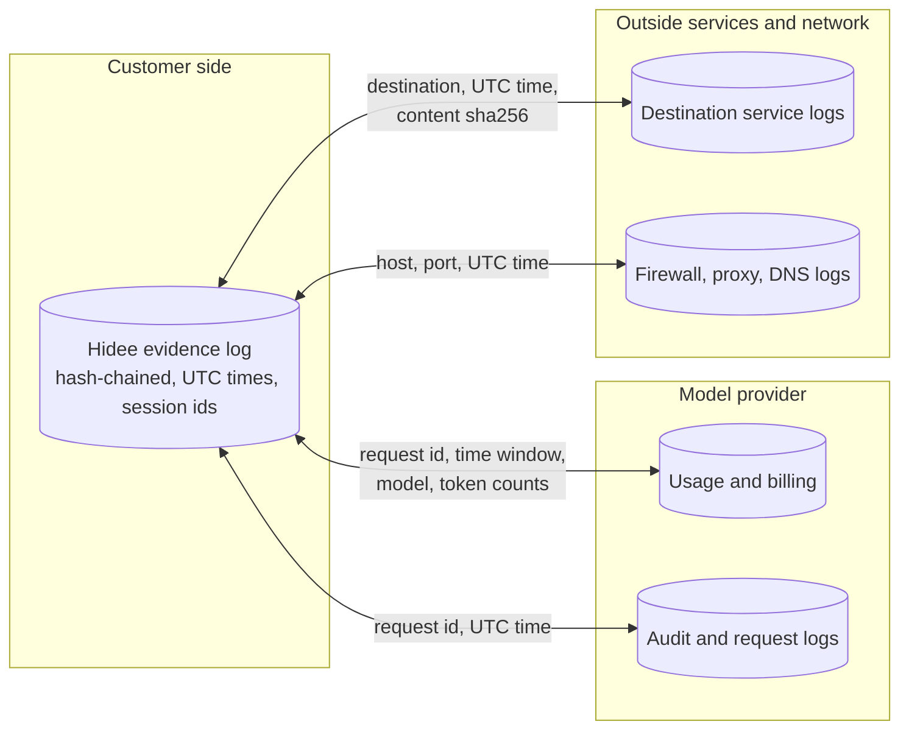

# Auditable evidence: what Hidee records, why it can be audited, and why a middle layer makes it possible

## 1. The gap



Each party sees one slice. No one in this picture records who decided to let a detail leave, what that person saw,
and what actually ran.

When an AI agent acts for a small business or a person, three parties hold some record of what happened, and
none of them gives the customer an account they can rely on.

- **The model provider** logs requests and responses on its own servers. The customer usually cannot see these
  logs in full, cannot choose how long they are kept, and cannot check that they are complete. The provider also
  sees only text. It does not see which command ran on the customer's computer, what that command touched, or who
  approved it.
- **The agent's own transcript** is written by the agent process. It can be compacted when the context fills up,
  it can be edited by anything with access to the file (including the agent), and it records what the agent says
  it did, which is not the same as what happened.
- **The destination service** (a search engine, a file host, an email API) sees only what arrived there, and its
  logs belong to a third party.

What is missing is a record held by the party that carries the responsibility: who decided to let each piece of
information leave, what they were shown when they decided, and what the tool actually executed.

## 2. What Hidee records



Hidee sits on the path every action must take. It sees the request, settles it with the rules or the person, and
writes what happened to a log that the agent never touches.

For every session it starts, Hidee appends records to `~/.hidee/app/evidence/YYYY-MM-DD.jsonl`. Each record has a
sequence number, a UTC time, the session id, an event type, its data, the hash of the previous record, and its own
hash.

| Record | What it establishes |
| :- | :- |
| `session_start` | which agent ran, in which folder, with which sign-in method (a label, never a key), with or without safe mode and learn mode, and under which OS user |
| `prompt` | what the person asked the agent to do |
| `tool_call` | what the model requested, as the model wrote it, and whether the step stays local or leaves the computer |
| `decision` | who decided (the rules, a person, a timeout, or Hidee's memory of withheld details), the choice (approve, shorter version, reject, blocked, timed out), the reason, the categories of sensitive data found, how many seconds the decision took, for a person the OS user, and with a rejection the reason the person wrote for the agent (`note`, as written; Hidee never fills it in). A rejection's record also lists the categories withheld memory now remembers (`withheld`; categories only). The categories include the free-text ones (`mental_health`, `legal`, `known_fact`, and the others in RULES.md); the highlighted sentence itself is never written to a decision record |
| `executed` | the input that actually ran when it differs from the request (the shorter version), with the categories it removed (`removed`), kept because they are where the call is sent (`kept_destination`), and kept because the user's request names them (`kept_requested`); categories only, never values |
| `drafted` | a message to a person that the user chose to save as a draft; nothing left the computer |
| `tool_result` / `tool_failure` | what the tool returned or why it failed |
| `answer` | what the model told the person at the end of the turn |
| `model_request` | one model request of a Claude Code session: the message id the provider also holds (`msg_…`), the API request id (`req_…`), the model, the input, cache read, cache creation, and output tokens, and the time of the request |
| `connection` | every network connection the session made through Hidee's gate: host, port, whether it was allowed, and whether it went to the model provider |
| `session_end` | when and how the session ended |

Long text (prompts, results, answers, tool input) is stored as an excerpt with secrets masked, together with its
length and the sha256 of the full text. The log stays small and avoids keeping a second copy of every file, yet a
full copy produced later can be checked against the fingerprint.

Read together, these records answer the questions an investigation asks: Did this customer's address leave the
computer? To whom, and when? Did a person approve it, or did a rule? What did that person see? Did the agent try
again after being told no? Which connections did the session make?

One tool call, step by step, with the record written at each step:



## 3. Why the record can be audited

**It is written from an independent vantage point.** Hooks and the network gate write the log. They run as
separate processes, outside the model's context. The model never sees the log and has no tool to write it, and
context compaction does not touch it. The record does not depend on the agent's own report.

**It covers every step that passes through Hidee, before the step runs.**


 Each tool call reaches Hidee's hook
before it executes. If Hidee cannot answer, the hook blocks the call (it exits with code 2, which Claude Code,
Gemini CLI, and Codex CLI all treat as a block), so a call does not run silently around the record. In safe mode
the operating system sandbox closes the other paths: commands cannot write outside the project, cannot reach
services on the computer, and send their network traffic through Hidee's gate.

**It binds the request, the decision, and the execution together.** For one action the log holds what the model
asked for, what Hidee found in it, who decided and how, and what actually ran. When the executed input differs from
the request, both versions are there. A provider log or an agent transcript cannot show this divergence, because
neither sees both sides of the decision.

**It attributes decisions.** Each record carries its session. A person's decision carries the OS user and the time
it took, so a rubber-stamped approval (one second) looks different from a considered one.

**It is tamper-evident.**



Each record stores the hash of the record before it, so the records form a chain. Editing, deleting, inserting,
or reordering any record breaks the chain from that point on. `hidee evidence verify` recomputes the chain and
reports the first break. The Evidence page shows the latest hash; writing it down or sending it to someone fixes
the state of the log at that moment, so a later rewrite of the whole chain becomes detectable. `hidee evidence
export` writes a bundle whose manifest states the first and last hash, and the bundle can be verified on another
machine.

**It is kept out of the agent's reach.** In safe mode the sandbox denies the agent writes to `~/.hidee`, where the
log lives.

## 4. Why a middle layer makes this possible

**The tool boundary is where intent becomes action.** A model only produces text. Nothing happens in the world
until the agent turns a requested tool call into an executed one. Every effect, whether reading a file, running a
command, searching the web, or sending a message, crosses that boundary. A layer placed there sees each action
before it happens and can attach a human decision to it. This is the one position from which both sides are
visible: the provider sees only the conversation, and the destination sees only what arrives.

**It follows the reference monitor idea.** Security engineering has long described a reference monitor as a
mechanism that is always invoked, tamper-resistant, and small enough to check. Hidee applies this idea to agent
tool calls: the hooks are the point of mediation, the sandbox and the gate close the paths around it, and the hash
chain makes later changes to the record visible.

**The customer runs it.** Hidee runs on the customer's computer, under the customer's control, and does not depend
on the provider's cooperation or retention policy. The evidence belongs to the party that answers for the agent's
actions.

**It works across agents.** Claude Code, Gemini CLI, and Codex CLI produce the same record format, so one
procedure audits all of them.

## 5. Limits

The log covers what passes through Hidee: sessions started in Hidee, their hooks, and their gate. An agent started
elsewhere leaves no record. Tools that run on the provider's side, such as Codex's hosted web search, never reach a
local hook; Hidee turns that tool off in safe mode. Outside safe mode, a program that ignores proxy settings can
open connections the gate does not see. Codex CLI runs a hook that crashes or times out as if it had allowed the
call; Hidee's own failure path exits with code 2 to avoid this, but a hook killed by the system would still fail
open. Excerpts mask API keys, card numbers, and government IDs; other details, such as email addresses, stay
readable in the excerpt. A person with full control of the computer can rewrite the whole chain; shared head
hashes, and signed checkpoints in a later version, make that detectable. Hidee records what crossed its hooks, not
the model's internal reasoning. Per-request model usage comes from Claude Code's own transcript and is recorded
for Claude Code sessions only (section 7).

## 6. How to audit a session

1. Run `hidee evidence verify` (or open the Evidence page). An intact chain means no record was changed after it
   was written, back to the first record or to the last head hash you shared.
2. Export the days in question with `hidee evidence export --from YYYY-MM-DD --to YYYY-MM-DD` and keep the
   bundle with its manifest.
3. To answer "did this detail leave?", search the session's `tool_call`, `decision`, `executed`, and `connection`
   records for the recipient and the category, and read the decision that governed it.
4. To check a full document against the log, compute its sha256 and compare it with the fingerprint in the
   `prompt`, `tool_result`, or `answer` record.
5. To corroborate the log with independent records, write the forensic timeline (`hidee evidence timeline`) and
   the reconciliation report (`hidee evidence reconcile`), then follow section 7.

The record format and the exact hash computation are in [DATA_AND_EVIDENCE.md](DATA_AND_EVIDENCE.md).

## 7. Reconciliation: comparing your ledger with the provider's



The evidence log is one book, kept by the customer. The model provider keeps another (usage, billing, and audit
logs), each destination service keeps its own access logs, and the customer's network keeps firewall, proxy, and
DNS logs. These books are written by different parties for different reasons, so they are independent. Comparing
them works like reconciling two sets of accounts: each entry in one book should have its counterpart in the other,
and every gap needs an explanation.

**The goal is network forensics.** An investigator wants to reconstruct what happened and then corroborate it.
Hidee gives the first part: a timeline of prompts, tool calls, decisions, executed inputs, connections, and model
requests, in order, on an intact hash chain. The second part comes from the independent books. Each Hidee record
is checked against a source Hidee does not control: model requests against the provider's usage and audit logs by
request id and time, outbound actions against the destination's logs, and connections against firewall, proxy,
or DNS logs by host, port, and UTC time. A record that two independent books agree on is strong evidence; a record
that only one book holds is a finding.

**Join keys.** Every Hidee time is UTC with milliseconds (`2026-11-04T14:02:24.118Z`), and every record carries a
session id. A model request carries the message id (`msg_…`) and the API request id (`req_…`) that the provider
also holds. A decision carries the destination; a connection carries host and port; text carries the sha256 of the
full content. Allow for clock skew between machines when matching times, and keep the window small (seconds, not
minutes).

**Two commands.**

```bash
hidee evidence reconcile [--from YYYY-MM-DD] [--to YYYY-MM-DD] [--format md|csv]
hidee evidence timeline  [--from YYYY-MM-DD] [--to YYYY-MM-DD] [--out hidee-timeline.csv]
```

`reconcile` totals the log per UTC day: model requests and tokens per model, outbound actions per destination by
decision and by who decided, and connections per host (allowed or refused). The CSV form lists every model
request with its ids, for matching one by one. `timeline` writes one row per record, in sequence order, as plain
RFC 4180 CSV with ISO 8601 UTC times, so it loads into spreadsheets and common timeline tools. Both start with the
chain's status and head hash (the Markdown report in its header; the timeline in a manifest beside the CSV), because
a comparison is only meaningful on an intact chain. The Evidence page offers both as downloads for a chosen range
of days.

**What to compare, and what a mismatch means.**

| You see | What it usually means |
| :- | :- |
| The provider bills request ids your ledger lacks | Requests made outside Hidee: another program, an agent started outside Hidee, another machine, or someone else using the same key. Check where the key is used, and rotate it if the requests are not yours. Claude Code also makes small requests of its own that never reach the transcript (for example, background calls on a smaller model); expect a few of these. |
| Your ledger holds request ids the provider lacks | The wrong account, project, or region was checked, or the provider's log has expired or is aggregated. If none of these apply, the transcript Hidee read did not match what was sent, which is itself a finding. |
| Same request ids, different token counts | Billing rounds or groups cache tokens differently. Compare input, cache read, cache creation, and output separately before drawing a conclusion. |
| The provider's audit log shows content at a time when your ledger shows no session | Use of the account outside Hidee. |
| Your ledger shows data sent to a destination whose log lacks it | Delivery failed (check the `tool_failure` or `tool_result` record), the request went to another host behind the same name, or the destination did not log it. |
| A destination's log shows data your ledger never approved | The data left by a path Hidee did not see: a session started elsewhere, a program that ignores proxy settings outside safe mode, or a person acting by hand. |
| A firewall or proxy log shows a connection from the computer that the timeline lacks | A program outside Hidee's sessions made it, or a session outside safe mode bypassed the proxy. |
| A `connection` record that the network logs lack | The connection was refused by the gate before leaving (check `allowed`), or the network logs do not cover that path. |

The provider's request ids and log formats differ by provider and by plan. Obtain them from the provider (its
console, usage export, or audit log API) before you start.

**Worked example: "Did the patient's email reach files.example.com on 2026-11-04?"**

1. Run `hidee evidence verify`. The chain is intact; write down the head hash.
2. Write the day's timeline: `hidee evidence timeline --from 2026-11-04 --to 2026-11-04 --out day.csv`.
3. Keep the rows whose `destination` is `files.example.com` or `files.example.com:443`, and the rows of the same
   `session` just before them. The result, shortened:

| utc_time | seq | event | actor | tool | destination | decision | detail |
| :- | -: | :- | :- | :- | :- | :- | :- |
| 2026-11-04T14:02:11.204Z | 811 | tool_call | agent | WebFetch | | | outside: {"url": "https://files.example.com/share?to=maria.lopez@example.org"} |
| 2026-11-04T14:02:23.612Z | 812 | decision | person:maria | | files.example.com | minimal | fetch: Owner approved the shorter version. Found: email. |
| 2026-11-04T14:02:23.613Z | 813 | executed | hidee | | | | {"url": "https://files.example.com/share?to=[email]"} |
| 2026-11-04T14:02:24.118Z | 814 | connection | gate | | files.example.com:443 | allowed | https://files.example.com:443 |
| 2026-11-04T14:02:24.902Z | 815 | tool_result | agent | WebFetch | | | (excerpt; sha256 in its own column) |

4. Read it. The model asked to send the address. Maria chose the shorter version after twelve seconds, the
   executed input carried `[email]` instead of the address, and the gate saw one connection to the host at
   14:02:24. By Hidee's ledger, the address did not reach files.example.com through this call.
5. Corroborate. The destination's access log should show one request near 14:02:24Z whose query holds `[email]`,
   and no request that day holding the address. The firewall or proxy log should show one connection from this
   computer to files.example.com:443 at that time, and none that the timeline lacks. If a later row in any session
   names the same destination, repeat the check for it.
6. Check the other recipient. The address was in the conversation, so it reached the model provider. The
   `prompt` row and the `model_request` rows around 14:02 give the request ids; the provider's audit log, matched
   on those ids, shows which requests carried it.

**Limits.** Per-request usage is recorded for Claude Code sessions only: Hidee reads Claude Code's transcript
(only `.jsonl` files under `~/.claude/projects`, including sub-agent transcripts) when a turn ends and when the
session ends. The hook events Hidee receives from Gemini CLI and Codex CLI carry no token usage, so their sessions
have no `model_request` records; reconcile them by the gate's connections to the model host and by time.
`model_request` records are as accurate as the transcript at the moment Hidee reads it; the gate's `connection`
records to the model host are an independent count of connections, not of requests, since one connection carries
many requests. Requests are recorded at the end of each turn, not as they happen, and a turn's last request may be
recorded a few seconds after its `answer`. HTTPS hides request contents from the gate: it sees host and port, not
what was sent, so content questions rest on the hook records and their sha256 fingerprints. Hidee holds only the
customer's book; the provider's ids and formats must come from the provider.
