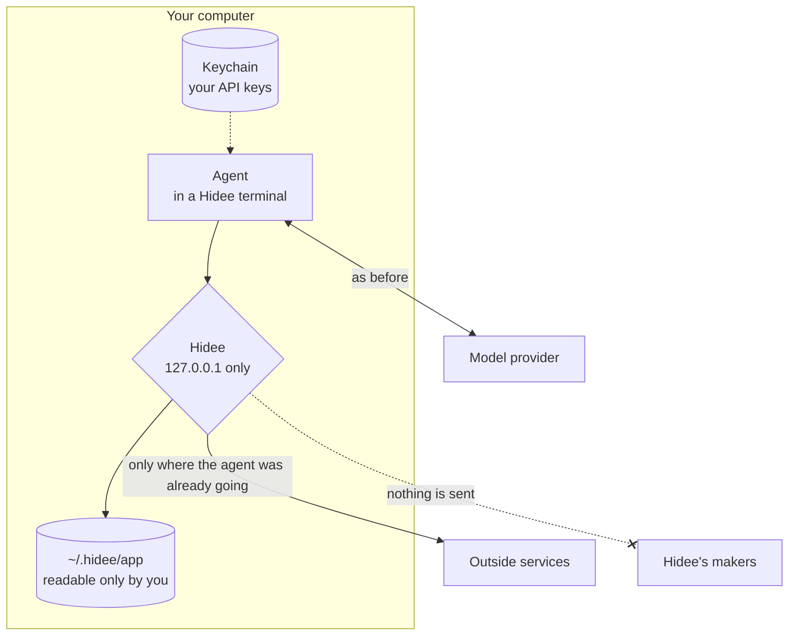

# Why Hidee is safe to use

Hidee sits between an AI agent and the world, so it sees what the agent sees. That position only helps if Hidee
itself is not one more place your data goes. This page explains the design that keeps it that way. Each point
names the mechanism in the code that backs it.

Hidee adds no new destination. The agent still talks to its own model provider, and the outside services it
reaches are the ones it was already going to reach. Nothing goes to the people who make Hidee.

## 1. Nothing is sent to us

Hidee has no account and no telemetry. The only network connections Hidee itself opens are:

- the hooks, which talk to Hidee on `127.0.0.1`;
- the network gate, which forwards the session's own connections to the hosts the session asked for;
- **Test it** on the Settings page, which sends one read-only request (list models) to the provider of that key,
  only when you click it;
- **the update check, only if you allow it.** The first time `hidee app` runs in a terminal it asks once:
  "Check for Hidee updates every 2 weeks? [Y/n]". With a yes, `hidee app` fetches `https://hidee.net/latest.json`
  at most once every two weeks: a plain request whose only header is `User-Agent: hidee/<version>`, with no
  account, id, or usage data (the server sees your IP address, as with any request). With a no, Hidee never checks
  on its own. **Check now** in Settings and `hidee update` check once, when you ask. You can change the answer in
  Settings; it is kept in `update.json` in Hidee's folder.

Nothing installs without your yes. An update installs only if the file's SHA-256 matches and its Ed25519 signature
verifies against the release key built into Hidee (`hidee/update.py`), so a changed file or a compromised download
server cannot push code to you.

Detection runs inside Hidee: the pattern detectors, known data from your sensitive files, and the free-text detector
(sensitive facts in plain sentences and restatements of your files) use word lists and arithmetic on this computer.
There is no model and no download, and no text is sent anywhere to be classified.

A test (`tests/test_privacy.py`) starts the app with the update check allowed and due, opens every page, and fails
if anything tries to connect to a host other than this computer: the app itself never checks.

## 2. Your data stays on your computer, readable only by you

Everything Hidee keeps lives in one folder, `~/.hidee/app` by default: the checkpoint database, the rules, the
evidence log, and one folder of settings per session. When the app starts, it locks that folder to your user
account (folders `0700`, files `0600`), and new evidence files are created `0600`. API keys you save in Settings go
to the macOS Keychain (on other systems, a file only you can read) and are handed to one session through its
environment, never its command line.

## 3. It keeps as little as it can

Hidee does not copy your files. For prompts, tool results, and answers, the evidence log keeps a short excerpt with
API keys, card numbers, and government IDs masked, plus the length and sha256 fingerprint of the whole text. Other
details in an excerpt, such as an email address, stay readable, because the excerpt has to show what happened.

## 4. You can see all of it

The records are plain JSON Lines and SQLite. The **Your data** section of Settings lists each part, its size, and
its location, and opens the folder. To remove everything, quit Hidee and delete the folder; your keys are in the
keychain under "hidee".

## 5. Only this computer can use the interface

The app listens on `127.0.0.1` only and rejects other Host headers, so a web page that renames itself cannot reach
it. The terminal connection needs a per-run secret and Hidee's own origin; every form needs a CSRF token; the hooks
need a per-run hook token.

## 6. It is a visible, explainable terminal

Hidee does not act on its own. It runs the agent you chose in a terminal you can see, shows every step on the live
map, explains it in Behind the agent, and records it in the evidence log. When it holds a step back, it says why,
and the decision stays with you.

## Limits

Hidee protects what passes through it; it does not make the model provider keep less. What your agent sends to
its provider is governed by that provider's terms. A person or program with full control of your computer, or with
your user account, can read Hidee's folder like any other file you own. The code still contains a client for the
Jev review service, carried over from the research prototype; the app never calls it.
